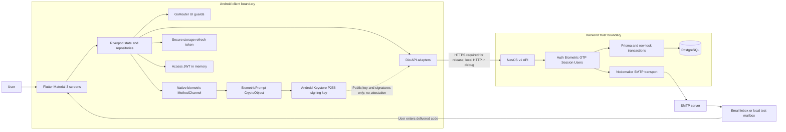
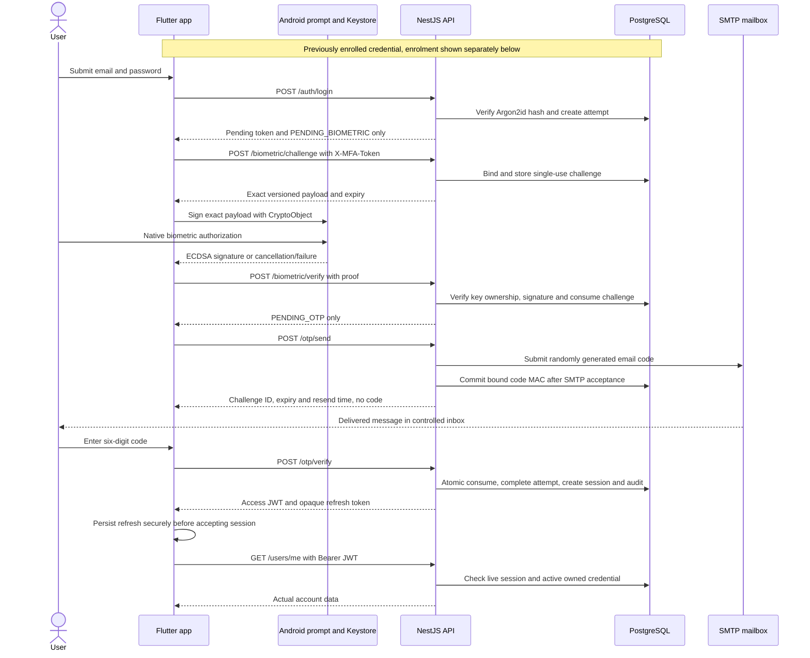
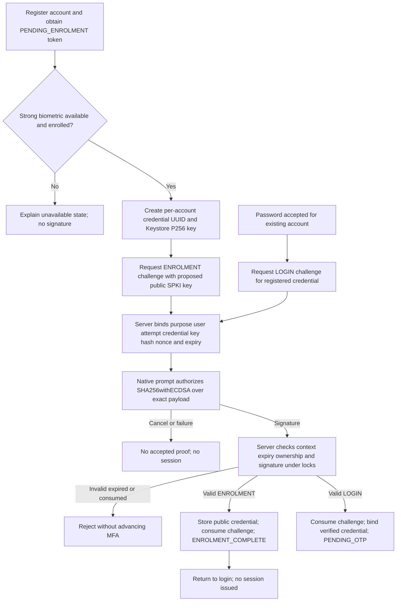
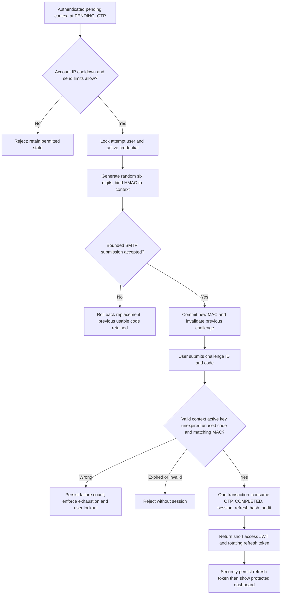
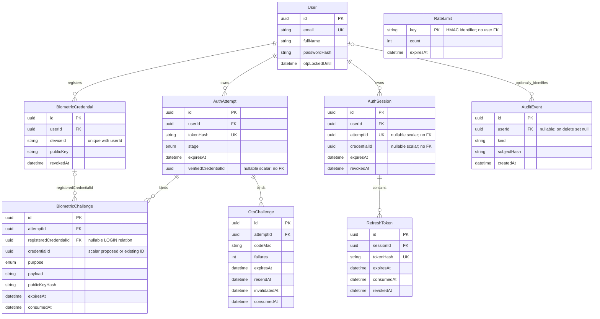
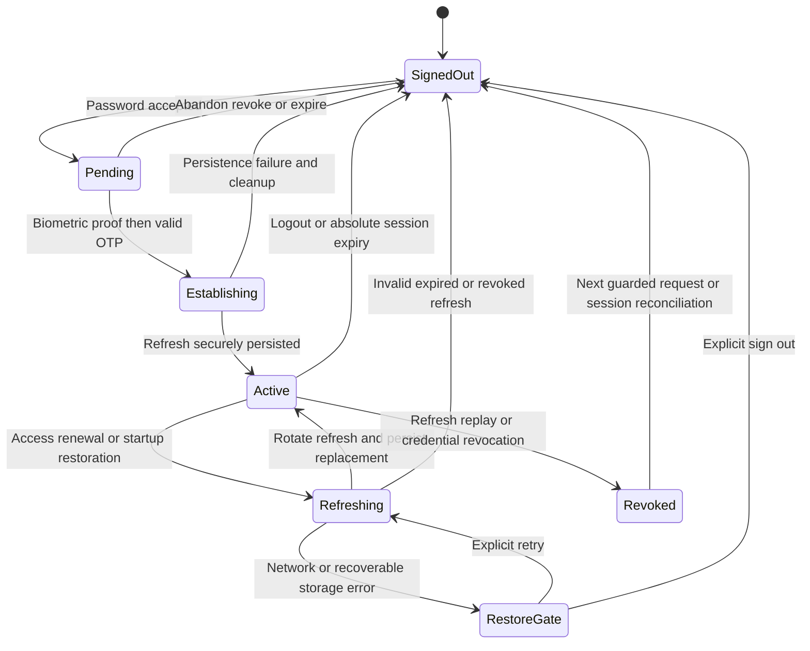
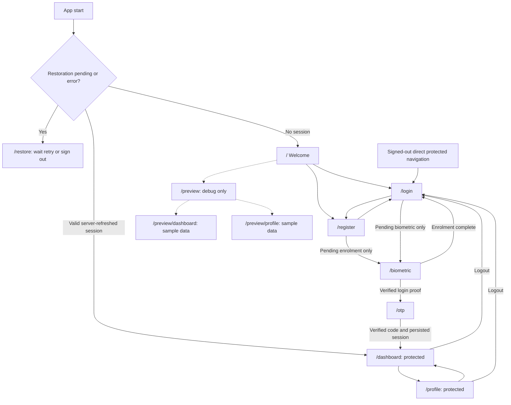

# Architecture diagrams

Seven diagrams describe the implemented system as reviewed on 30 October 2026. They are text-based design views, not additional test evidence. Source contracts: [API](../api-contract.md), [schema](../../backend/prisma/schema.prisma), [router](../../lib/app/router/app_router.dart), [biometric service](../../backend/src/biometric/biometric.service.ts), [OTP service](../../backend/src/otp/otp.service.ts), [session service](../../backend/src/session/session.service.ts).

## 1. High-level system architecture

The debug mailbox is loopback tooling, not a production delivery provider. Native key restrictions are client-side; the server cannot establish hardware backing from the submitted public key/signature.

## 2. Authentication sequence

All unsuccessful proof/code paths fail closed; this success-path diagram does not turn SMTP acceptance into a delivery guarantee. A secure-storage failure prevents the client from treating session establishment as successful.

## 3. Biometric enrolment and challenge-response

The server has **no key-attestation verification**. The stock debug client may use an OS-managed software-backed key; the nondebug client additionally checks local hardware metadata. Neither local check proves provenance to a modified-client-resistant server. Missing/revoked keys are not silently replaced using only the password.

## 4. OTP verification and MFA completion

Default code lifetime is at most five minutes and never exceeds the pending attempt. Five incorrect codes trigger the account lock; send cooldown defaults to 60 seconds and only three accepted sends are allowed per attempt. SMTP is external to PostgreSQL: acceptance followed by a database failure can still produce an unusable email. There is no distributed transaction or durable plaintext outbox.

## 5. Database entity relationships

This is a selected-field view of all nine models, not a migration script. Solid relationships above correspond to actual Prisma foreign keys. `AuthAttempt.verifiedCredentialId`, `AuthSession.attemptId`, `AuthSession.credentialId` and `BiometricChallenge.credentialId` are application-validated scalar references, **not additional database foreign keys**. The optional registered-credential relation supports enrolment before a credential exists. The session's unique attempt scalar prevents two sessions for one completed attempt. Passwords, raw OTPs and private biometric keys are not stored as plaintext in this schema.

## 6. Session lifecycle

Access JWTs are in memory; only refresh tokens persist in secure storage. Every protected request also checks the database session and credential. Reuse of a consumed refresh token revokes its session family, including the winner of a concurrent rotation. Logout clears UI state immediately and independently attempts storage deletion and server revocation. If both fail, durable logout across restart cannot be guaranteed. Already-authorized in-flight requests may finish. Startup restoration obtains server approval before granting access; the executed native retest recreated the provider container rather than killing the OS process.

## 7. Application navigation

`/biometric` and `/otp` are navigable screens, but usable actions require their appropriate server-controlled pending context; opening a page does not grant a session. Authenticated visits to guest authentication routes redirect to the dashboard. Unknown routes render Welcome. Preview routes are omitted in release and do not issue credentials or authorize backend requests. The diagram shows application navigation, not an implemented Android deep-link registration.
