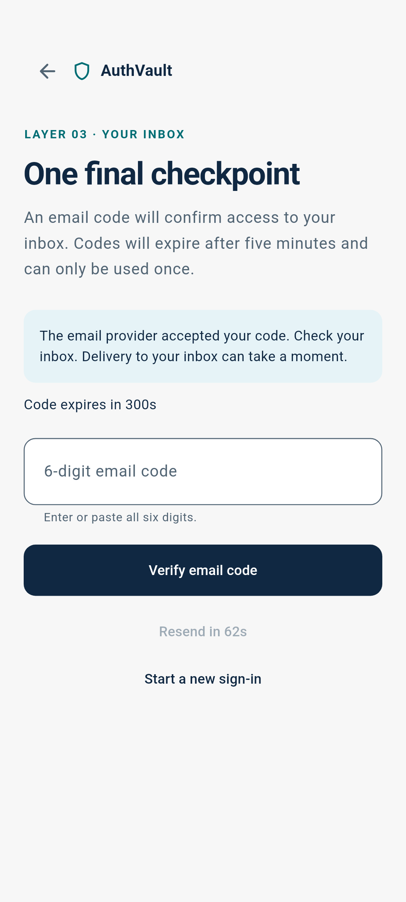
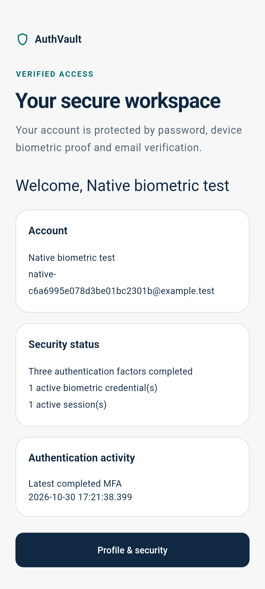
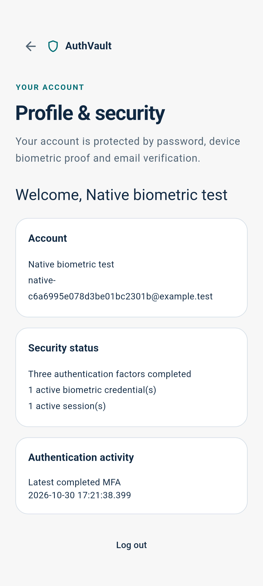
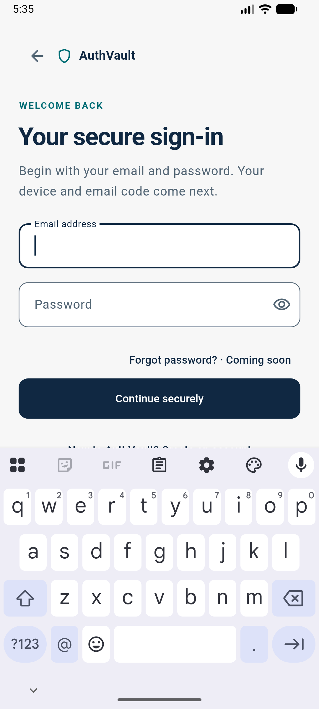

# AuthVault: Design and Evaluation of an Android Multi-Step Authentication Prototype

**Academic report — Phase 7, 30 October 2026**  
Author: **[Full name]** · Student number: **[ID]**  
Institution/department: **[Institution and department]**  
Programme/award: **[Degree]** · Supervisor: **[Name/title]**  
Submission date: **[Institutional date]**

This manuscript uses a provisional numbered reference style. No institutional template, marking rubric or submission guideline was found in the repository. Required declarations, approval pages, abstract length, typography, pagination, word limit and final citation style remain subject to confirmation in the [submission checklist](submission-checklist.md). No signature, ethics approval or supervisor endorsement is implied.

## Abstract

AuthVault is an academic mobile authentication prototype integrating a Flutter Android client, a NestJS API and PostgreSQL persistence. Its login sequence verifies a password, a signature produced through the stock client's Android biometric prompt, and a randomly generated email code before issuing session credentials. The implementation separates pending authentication attempts from authenticated sessions, binds cryptographic challenges to their context, stores password hashes and OTP MACs rather than plaintext secrets, and rotates refresh credentials with replay detection. The investigation combines implementation review, automated tests, local HTTP/database integration, security regression cases and an emulator demonstration. Phase 6 recorded 87 passing Flutter tests and 69 passing backend tests. Reported line coverage was 76.84% for Flutter and 99.45% for the backend, with 83.74% backend branch coverage. A successful manually assisted native MFA scenario took 29 seconds excluding build and installation; a separate five-scenario local server experiment had a 390.90 ms median excluding human/native biometric time. These observations demonstrate prototype behavior within the tested environment, not production performance or universal biometric assurance. The server does not verify key attestation and accepts software-key signatures. Physical devices, iOS, production email delivery, recovery and operational deployment remain unvalidated or incomplete. The contribution is an inspectable authentication state machine and evidence-based evaluation, including explicit disclosure of the gap between local biometric authorization and remotely established authenticator provenance.

## Contents

1. [Introduction](#chapter-1--introduction)
2. [Literature review](#chapter-2--literature-review)
3. [System analysis and design](#chapter-3--system-analysis-and-design)
4. [Implementation](#chapter-4--implementation)
5. [Testing, results and evaluation](#chapter-5--testing-results-and-evaluation)
6. [Conclusion and recommendations](#chapter-6--conclusion-and-recommendations)

Companion materials: [references](references.md), [seven diagrams](architecture-diagrams.md), [evaluation details](testing-and-evaluation.md), [defense questions](defense-questions.md), [presentation](presentation-outline.md), [demonstration](demonstration-guide.md).

## Chapter 1 — Introduction

### 1.1 Background

Authentication establishes whether a claimant can demonstrate control of an account's accepted authenticators. Authorization subsequently determines which resources that identity may access. A login form is therefore only one part of a system that must also protect enrollment, verification transitions, tokens, recovery and logout. Password-only access concentrates security in a reusable secret: disclosure through phishing, reuse or compromise can permit impersonation. A password hash reduces damage from database disclosure but does not make a stolen correct password unusable.

Adding independent evidence can reduce reliance on that single secret, while increasing implementation and interaction costs. Bonneau and colleagues' comparative framework shows why authentication proposals must be assessed across usability, deployability and security rather than a single desirable property [1](references.md#ref-1). AuthVault applies that motivation to a bounded academic implementation. It does not establish that adding more screens automatically produces independent factors or standards-conformant assurance.

### 1.2 Problem statement

A mobile prototype can display password, fingerprint and code screens while granting protected access after only a local success flag. Such a design confuses interface progression with server authorization. Even when signatures and OTPs are real, omitted replay checks, concurrent verification, token reuse and restoration races can undermine the intended sequence. The engineering problem is to make the backend enforce ordered verification, ensure that the client handles incomplete/error states honestly, and evaluate the resulting system without overstating what emulator evidence proves.

A further problem is evidential: a valid public-key signature proves control of a signing key, not automatically the hardware or biometric restrictions under which that key was used. This distinction is central to the final evaluation.

### 1.3 Aim and objectives

The aim is to design, implement and evaluate an Android authentication prototype that separates pending verification from authenticated access and exposes its security limits clearly.

| Objective | Intended outcome | Final assessment |
| --- | --- | --- |
| O1 | Maintain a responsive, accessible authentication interface and centralized navigation | Implemented; widget and emulator evidence, limited device range |
| O2 | Verify passwords using backend validation and adaptive hashing | Implemented with Argon2id; signup enumeration remains |
| O3 | Integrate native biometric-authorized challenge signing and reject invalid/replayed proofs | Implemented in stock Android client and backend; remote biometric provenance not established |
| O4 | Require a real delivered email code before completing the login attempt | Implemented and tested with controlled SMTP; external delivery not validated |
| O5 | Protect account APIs and manage restoration, refresh rotation and logout | Implemented with regression evidence; joint network/storage failure remains a limitation |
| O6 | Evaluate correctness, coverage, security and local performance reproducibly | Completed within Phase 6 scope; no participant study or production benchmark |

These objectives synthesize the staged project requirements; their achievement is bounded by the evidence, rather than declaring all security goals fully solved.

### 1.4 Research questions

RQ1: Can a client/backend state machine keep password acceptance and incomplete MFA from granting protected access? RQ2: How can native challenge signing, emailed codes and session rotation be integrated while handling replay and concurrency? RQ3: What do the executed tests and local measurements establish about correctness and responsiveness? RQ4: Which security claims remain unsupported when attestation, physical-device testing and operational validation are absent?

The method is constructive engineering with empirical software validation. It is not a randomized comparison of authentication systems or a study of human biometric performance.

### 1.5 Significance

The project provides a compact implementation in which UI state, server state and cryptographic evidence can be inspected together. It illustrates that credentials should be issued only after the required checks commit, and that revocation must remain effective beyond route protection. Its academic value includes negative findings: software-key acceptance and unresolved deployment controls qualify the successful functional demonstration.

### 1.6 Scope and limitations

The delivered scope is Android, a local NestJS/PostgreSQL backend, controlled SMTP, account/security screens and automated validation. The test target was an Android API 37 arm64 emulator. iOS native signing, physical-device security, account recovery, password reset, key replacement, external email delivery and deployed operations are outside the validated scope. The debug preview is explicitly sample UI and cannot establish an authenticated session. The system is an academic prototype, **not production-ready**, phishing-resistant, certified or assigned a NIST assurance level.

### 1.7 Organization

Chapter 2 establishes the conceptual and standards background. Chapter 3 defines requirements and the implemented design. Chapter 4 traces concrete components and workflows. Chapter 5 evaluates recorded evidence and threats to validity. Chapter 6 assesses objectives and proposes future work without implementing a further development phase.

## Chapter 2 — Literature review

### 2.1 Authentication and assurance

Knowledge, possession and inherence are useful categories for reasoning about authenticators, but counting checkpoints is insufficient. NIST SP 800-63B-4 treats biometrics as an activation mechanism within an authenticator rather than a standalone remotely transmitted secret [2](references.md#ref-2). In AuthVault, the password is knowledge; the device key supplies possession evidence; local biometrics activate stock-client signing. Email adds an inbox-control check whose independence depends on account and device compromise. Access to all mechanisms on one phone can correlate their failure.

### 2.2 Password-based authentication

Passwords are familiar and inexpensive to deploy, but reusable secrets are exposed to guessing, reuse and phishing. The comparative literature reports substantial tradeoffs rather than a universally superior replacement [1](references.md#ref-1). Memory-hard hashing raises the cost of offline guessing after a hash disclosure; it does not prevent online abuse or compensate for weak recovery. RFC 9106 describes Argon2, and OWASP recommends adaptive password hashing with salts and appropriate work factors [3](references.md#ref-3), [4](references.md#ref-4).

AuthVault's Argon2id parameters are an implementation choice documented in Chapter 4. Their inclusion does not demonstrate resistance to every attacker budget or production denial-of-service load. Online quotas and resource admission must be evaluated separately.

### 2.3 Multi-factor and biometric authentication

A local biometric match should authorize a narrowly scoped operation, rather than simply return an untrusted Boolean to a remote service. Android provides BiometricPrompt integration with a CryptoObject for this purpose [6](references.md#ref-6). Android Keystore can restrict private-key use, but security properties depend on device support and enforcement level [5](references.md#ref-5).

Raw fingerprint or face templates need not be sent to AuthVault's server. The prototype instead transmits a public key and signatures. This reduces the application's handling of sensitive biometric material, while leaving the operating system responsible for biometric matching. It does not establish a measured false-acceptance or false-rejection rate. Android's attestation documentation describes a separate remote verification process for key provenance [7](references.md#ref-7); AuthVault does not implement that process.

### 2.4 Challenge-response cryptography

A verifier can send a fresh challenge and check a signature using an enrolled public key. Freshness alone is insufficient if a proof can be moved between users, operations or attempts. AuthVault therefore binds the payload to user, attempt, credential, purpose, key fingerprint and expiry, and consumes it under transaction locks. This is the project's concrete design, not a claim that its custom protocol has been formally proven or implements WebAuthn/FIDO2. A correct signature establishes control of the enrolled key; the provenance gap remains even when replay is prevented.

### 2.5 One-time passwords and emailed codes

HOTP derives codes from a shared secret and counter; TOTP extends that construction using time [8](references.md#ref-8), [9](references.md#ref-9). AuthVault instead generates a fresh random six-digit code on the server and emails it. The backend stores a context-bound HMAC for comparison. The HMAC is storage protection, not an implementation of HOTP or TOTP.

Delivery, guessing limits, expiry and replacement are as relevant as code generation. NIST SP 800-63B-4 excludes email as an out-of-band authentication method [2](references.md#ref-2). Consequently, AuthVault's email step is an academic inbox-control checkpoint, not a basis for claiming NIST-conformant AAL2/AAL3. It is also susceptible to relay/phishing and mailbox compromise. Local SMTP acceptance and mailbox receipt demonstrate the development flow only.

### 2.6 Tokens and session management

JWT specifies a compact claims format, not a complete session policy [10](references.md#ref-10). JWT security guidance calls for explicit validation of algorithm, issuer, audience and token context [11](references.md#ref-11). AuthVault additionally checks its live database session and active credential, trading database work for immediate enforcement of revocation on subsequent requests.

Refresh tokens extend continuity and therefore need stronger lifecycle controls than simply issuing a long-lived bearer value. Rotation and replay detection are discussed in the OAuth security best-current-practice document [12](references.md#ref-12). AuthVault uses a custom rotation design with opaque tokens and family revocation. This comparison does not make the application an OAuth authorization server or an OpenID Connect provider.

### 2.7 Mobile application security and architectural guidance

OWASP MASVS organizes mobile assessment around areas including storage, cryptography, authentication and network communication [13](references.md#ref-13). It is a useful review lens for secure storage, debug/release separation and backup restrictions. The project has not completed every MASVS requirement and claims no certification.

Flutter's architecture guide recommends separating UI concerns from repositories and services [14](references.md#ref-14); NestJS modules support backend dependency organization [15](references.md#ref-15). These sources motivate maintainable boundaries. They do not provide comparative measurements proving Flutter or NestJS fastest or most secure. PostgreSQL row-lock behavior provides the concurrency foundation used in the backend [16](references.md#ref-16). SMTP transport supplies the delivery boundary [17](references.md#ref-17), whose external side effects cannot be rolled back with a database transaction.

### 2.8 Synthesis and project position

The literature motivates evaluating the complete authenticator lifecycle, not just credential entry. AuthVault combines established primitives in a constrained educational system: adaptive password hashing, native-authorized signing, bounded random-code verification and stateful session revocation. Its distinctive contribution is the implemented integration and documented validation, not a novel cryptographic primitive. The evaluation explicitly tests server state boundaries and reports where the stronger biometric-assurance objective remains unachieved.

## Chapter 3 — System analysis and design

### 3.1 Functional requirements and traceability

| ID | Requirement | Implementation/evidence |
| --- | --- | --- |
| FR1 | Register a normalized account with validated input | Auth DTO/service/repository; backend integration |
| FR2 | Password acceptance produces pending context only | AuthAttempt state; pending-Bearer denial tests |
| FR3 | Enrol a device public key through a signed challenge | Native channel and biometric service; native retest |
| FR4 | Verify fresh login proof before enabling OTP | Context-bound challenge and transactional consumption |
| FR5 | Deliver, expire, resend and limit real email codes | OTP/Mail services; SMTP and lockout tests |
| FR6 | Issue credentials only after atomic MFA completion | OTP transaction creates session and refresh hash |
| FR7 | Return only the authenticated user's account/security state | JWT plus live-session guard; cross-account regression |
| FR8 | Restore and rotate sessions without accepting stale client state | Session provider, serialized storage and backend rotation |
| FR9 | Logout locally and revoke server access | Independent cleanup attempts; JWT reuse denied |
| FR10 | Keep design previews separate from authentication | Debug-only routes; widget route-policy tests |

### 3.2 Non-functional requirements

NFR1 is maintainability through feature-first client modules and focused backend services. NFR2 is fail-closed verification with safe error envelopes and no plaintext password/OTP persistence. NFR3 is responsive, keyboard-aware UI with text scaling and reduced-motion support. NFR4 is reproducibility through locked dependencies, migrations and isolated fixtures. NFR5 is inspectable evidence and disclosure of residual risk. NFR6 is deployment protection through HTTPS configuration and restricted release manifests; full operational fulfillment remains incomplete.

Automated responsive/accessibility checks support NFR3 within tested dimensions, not universal accessibility certification. Local timing supports a bounded responsiveness observation, not a production service-level objective.

### 3.3 Architecture and technology selection

The [high-level architecture](architecture-diagrams.md#1-high-level-system-architecture) separates Android, backend and external mail boundaries. Flutter supplies shared Material 3 widgets; Riverpod handles dependency injection and asynchronous state; GoRouter centralizes navigation. The client data layer invokes Dio adapters rather than making API calls in widgets. A MethodChannel bridges to Android-specific signing, preserving the distinction between portable UI and native security behavior.

NestJS organizes Auth, Biometric, OTP, Session, Users, Health and Prisma modules. Strict TypeScript and DTO validation support explicit contracts. PostgreSQL stores durable identities, attempts, challenges, sessions and limits. Prisma models the schema and ordinary queries; transactions and explicit locks protect security transitions. SMTP is selected for an inspectable, replaceable mail transport, not a proven production provider. These choices prioritize implementation clarity and available tooling; no framework comparison experiment was conducted.

### 3.4 Authentication workflow

Registration returns `PENDING_ENROLMENT`. Successful signed enrolment reaches `ENROLMENT_COMPLETE` and returns the user to login; it issues no session. Correct password login returns `PENDING_BIOMETRIC`. Valid login proof advances the attempt to `PENDING_OTP`, tied to the verified credential. Only successful code verification moves it to `COMPLETED` and issues credentials. Abandoned attempts can be `REVOKED`; expiry is checked independently of stage.

The [authentication sequence](architecture-diagrams.md#2-authentication-sequence), [biometric flow](architecture-diagrams.md#3-biometric-enrolment-and-challenge-response) and [OTP flow](architecture-diagrams.md#4-otp-verification-and-mfa-completion) show these transitions. Neither a password nor an arbitrary route transition substitutes for them.

### 3.5 Database design

The [ER diagram](architecture-diagrams.md#5-database-entity-relationships) covers nine models: User, AuthAttempt, BiometricCredential, BiometricChallenge, OtpChallenge, AuthSession, RefreshToken, AuditEvent and RateLimit. User email is unique; credential uniqueness includes user and device ID. Attempt tokens and refresh tokens are stored as SHA-256 hashes of high-entropy opaque values; passwords use Argon2id; OTPs use a keyed MAC because six-digit codes have a small search space. Public keys are stored; private keys and biometric templates are absent.

Foreign keys connect users to attempts, credentials, sessions and optional audit identities, attempts to challenges, registered credentials to optional challenge relations, and sessions to refresh tokens. Some UUIDs are deliberately application-validated scalars rather than schema foreign keys: verifiedCredentialId, the session's attemptId/credentialId, and the biometric challenge's proposed credentialId. The report does not invent referential constraints that the database does not enforce. Three existing migrations define the delivered schema; Phase 6 introduced no migration.

### 3.6 API design

All routes use `/v1`. Full fields and response contracts remain in the [API contract](../api-contract.md).

| Boundary | Routes | Authorization/result |
| --- | --- | --- |
| Password | POST `/auth/register`, `/auth/login` | Validated credentials; pending result only |
| Attempt lifecycle | GET/DELETE `/auth/pending/:id` | `X-MFA-Token`; status or revocation |
| Biometric | POST `/biometric/challenge`, `/biometric/enrol`, `/biometric/verify` | Pending token, exact context and signed proof |
| Email code | POST `/otp/send`, `/otp/verify` | Pending token; accepted delivery metadata or final session |
| Session | POST `/auth/refresh`, `/auth/logout` | Opaque refresh credential; rotate or revoke |
| Account | GET `/users/me`, `/users/me/security` | Access Bearer JWT and live database checks |
| Health | GET `/health/live`, `/health/ready` | Liveness; readiness also checks database |

The pending token is not an access JWT. JSON requests are bounded to 8 KiB; unknown DTO properties are rejected. Errors expose a safe code/message/request ID rather than stack traces or database details. There is no separate resend endpoint: resend uses `/otp/send`. No arbitrary `/users/:id` lookup is exposed by the account API.

### 3.7 Security architecture and threat model

Assets include password verifiers, device signing keys, pending credentials, OTPs, session secrets and account information. Adversaries considered include remote guessers, replay attackers, modified clients and stolen-token holders. PostgreSQL/backend and configured secret custody remain trust assumptions; complete compromise of the backend or device OS is not solved by this prototype.

| Threat | Implemented defense and tested boundary | Residual risk |
| --- | --- | --- |
| Password guessing/account discovery | Argon2id, dummy unknown-user verification, account/IP quotas, generic login error | Signup 201 versus duplicate 400 reveals existence; address can be reserved before inbox verification |
| Proof replay or cross-context substitution | Versioned signed payload, nonce, expiry, owner/purpose checks, transactional consumption | No remote key attestation; software-key clients accepted |
| OTP guessing/replay | Bound HMAC, expiry, single use, cooldown/send limits, persistent failure count and user lockout | Mailbox compromise/phishing; email not a standards-conformant OOB authenticator |
| Concurrent verification/rotation | Consistent row-lock order, re-read under lock, atomic state change | Strict refresh replay revokes even a legitimate winner; availability tradeoff |
| Token theft/unauthorized account reads | Short JWT, explicit claims, secure refresh storage, live session/credential check | Compromised unlocked client and in-flight requests remain relevant |
| Persistence races/logout uncertainty | Generation guards, serialized storage mutations, independent revoke/delete attempts | Joint storage and network failure prevents guaranteed durable logout |
| Network/backup exposure | Release HTTPS requirement, no cleartext, backup and extraction restrictions | Deployed TLS, SMTP, OEM behavior and operational backups unvalidated |
| Resource exhaustion/data accumulation | Request size and selected persisted quotas | No complete global Argon admission policy or retention/cleanup lifecycle |

The confirmed High finding is insufficient remote assurance that a signature was biometric-authorized. An exportable software key can satisfy the server when the claimant also controls the required password and mailbox. That is not evidence of arbitrary takeover of a different account without its credentials. See the [risk register](../phase-6-security-audit.md) for severity/status rather than interpreting every row as remediated.

### 3.8 Navigation and session state

The [navigation view](architecture-diagrams.md#7-application-navigation) includes Welcome, Login, Registration, Biometric, OTP, restoration, Dashboard and Profile. Dashboard/Profile require client session state and server authorization for their data. `/preview` routes exist only in debug and show labeled sample layouts. They never issue real session credentials. The [session lifecycle](architecture-diagrams.md#6-session-lifecycle) models renewal, restoration, replay revocation and logout separately from page navigation.

## Chapter 4 — Implementation

### 4.1 Environment and repository structure

The validation environment recorded Flutter 3.47.9, Dart 3.13.7, Node 24.22.1, npm 11.19.1, NestJS 12.3.2, Prisma 7.10.1 and local PostgreSQL 17.10. Android tooling used SDK Platform 36, Build Tools 36.0.0, NDK 28.2.13676358 and Android Studio's bundled JDK 25, targeting `emulator-5554` on API 37 arm64. These are inspected environment versions, not claims of current latest releases. Xcode/CocoaPods and iOS validation were unavailable.

Client code resides in `lib/app`, `lib/core` and `lib/features/{auth,dashboard,profile}`. Auth separates domain entities/repository interfaces, data adapters and presentation providers/pages. Backend code resides in `backend/src` with module-specific services/controllers/repositories, schema/migrations in `backend/prisma`, and isolated tests in `backend/test`. Native Android signing is in `android/app/src/main/kotlin/com/example/authvault/`. Deployment settings and ignored `.env` values are not academic submission artifacts.

### 4.2 Registration and password verification

[Auth DTOs](../../backend/src/auth/auth.dto.ts) validate normalized email, full name and password constraints. Registration accepts names of 2–100 characters and passwords of 12–128 characters; login validates a supplied password without claiming new registration requirements were retroactively satisfied. [PasswordService](../../backend/src/auth/password.service.ts) uses Argon2id with 65,536 KiB memory, three iterations and parallelism one, with library-generated random salt. Unknown accounts use dummy-hash verification to reduce a simple timing distinction. [AuthService](../../backend/src/auth/auth.service.ts) creates random pending attempt credentials rather than access tokens.

Signup duplicate status still distinguishes an existing account. Generic wording alone does not remove that leak. Account recovery and password reset are not implemented; the UI marks unavailable functionality rather than simulating success.

### 4.3 Native enrolment and signed challenges

[BiometricKeyChannel](../../android/app/src/main/kotlin/com/example/authvault/BiometricKeyChannel.kt) creates an Android Keystore P-256 signing key whose alias incorporates account and credential UUIDs. A strong-biometric, authentication-per-use CryptoObject authorizes `SHA256withECDSA` signing. Enrollment changes invalidate the key. Cancellation/failure returns no accepted signature; late prompt results are not reused. The public SPKI key can be exported; the stock implementation checks that the private key cannot be exported. No fingerprint image/template or PIN is transmitted to the backend.

The [biometric service](../../backend/src/biometric/biometric.service.ts) builds an `authvault.biometric.v1` payload and checks the exact signed bytes, user, attempt, credential, purpose, nonce, key fingerprint and expiry. Challenges last at most two minutes and cannot outlive the pending attempt. Verification consumes a challenge and changes stage atomically. Registration context permits initial enrolment, not password-only replacement of a previously registered key.

Debug builds permit OS-managed software backing for emulator development. The nondebug client checks local hardware metadata; the server receives no validated attestation chain. The successful emulator reported `hardwareBackedReported: false`. Server integration fixtures deliberately use exportable Node EC keys, demonstrating the remote-assurance limitation rather than proving physical biometrics.

### 4.4 Email code implementation

[OtpService](../../backend/src/otp/otp.service.ts) uses cryptographically secure random generation for six decimal digits, including leading zeroes. Its HMAC-SHA-256 binds code, challenge, user, attempt and verified credential using an independent secret. The code lifetime is capped at five minutes and the pending deadline. Codes are single-use; replacement invalidates the prior challenge after accepted SMTP submission. Five incorrect submissions produce a persistent account lock for fifteen minutes. Defaults include a 60-second resend cooldown, three accepted sends per attempt, six send requests and fifteen verify requests per attempt per ten minutes, plus an IP quota.

[MailService](../../backend/src/otp/mail.service.ts) makes a bounded SMTP submission during the locked issuance operation. Failure rolls back a replacement so a previous valid code can remain usable. SMTP acceptance followed by a database error remains an unavoidable external-side-effect gap in this design. Codes exist transiently for sending and comparison, not as plaintext database fields. The local development mailbox deliberately holds fixture messages in memory; it is not a production API or secure external mail service.

### 4.5 JWTs, refresh rotation and protected account data

Successful OTP verification atomically consumes the code, completes the attempt, records MFA completion and creates a session plus a hashed opaque refresh credential. [SessionService](../../backend/src/session/session.service.ts) issues HS256 access JWTs with issuer `authvault`, audience `authvault-mobile`, explicit `at+jwt` type and required identity/session/expiry/method claims. Access validity defaults to five minutes, capped by an absolute seven-day session deadline. An `amr` label describes the enforced workflow; it is not attestation evidence.

The account guard checks the live session and an active, owned credential as well as JWT validity. [UsersController](../../backend/src/users/users.controller.ts) returns the authenticated subject's identity/security state rather than trusting a supplied user selector. Refresh rotates a random 32-byte credential under a session-row lock, stores only token hashes, and retains consumed-token relationships for replay detection. Reuse revokes the whole session family. Concurrent rotation can therefore produce one successful response followed by family revocation when the loser reuses the ancestor. A lost rotation response can require fresh login; no grace-period recovery is implemented.

### 4.6 Client state, restoration and logout

[Credentials providers](../../lib/features/auth/presentation/providers/credentials_providers.dart) own pending attempts and their timers. [Biometric providers](../../lib/features/auth/presentation/providers/biometric_providers.dart) coordinate native capability, key operations and proof submission. [Session providers](../../lib/features/auth/presentation/providers/session_providers.dart) retain access JWTs in memory and persist refresh credentials through secure storage. Restoration performs a real refresh before granting access, with explicit retry/signout at `/restore` when needed. Shared refresh work and generation checks prevent stale asynchronous completion from overwriting newer state; storage writes/deletes are serialized.

Logout clears client session state immediately, then independently attempts storage deletion and server revocation. A failure in one does not prevent the other attempt. Failure feedback remains honest because losing both storage cleanup and server connectivity cannot guarantee durable logout after restart. Backend revocation rejects subsequent protected JWT use, while already-authorized in-flight work may complete.

### 4.7 Interface and selected screenshots

Material 3 styling uses restrained navy, white and teal, shared form/card/button components, scrolling safe areas, keyboard-aware inputs, password visibility controls, paste/autofill-compatible six-digit entry and reduced-motion handling. OTP countdowns use server deadlines with client-clock approximation; server expiry remains authoritative. Protected pages load actual identity and security counts. UI preview pages are separate debug-only sample layouts.

**Figure 4.1 — OTP issued, before code entry.** Existing Phase 6 capture; no code is exposed. This documents the UI after local SMTP acceptance, not external delivery reliability.

**Figure 4.2 — Authenticated dashboard.** Real local fixture identity and account/security data; this is not the debug preview. The historical UI wording about “three authentication factors” describes completed workflow checkpoints, not independently established factors or remotely proven biometric assurance.

**Figure 4.3 — Authenticated profile/security layout.** Captured during the same successful native flow; long fixture email text wraps within its card.

**Figure 4.4 — Normal application entrypoint after integration.** Rebuilt debug app, signed-out login with empty fields and keyboard. It is a launch/UI observation, not an authenticated state.

No new screenshots were generated for this manuscript, and no image is offered as standalone proof of server authorization. The native evidence and backend assertions supply the complementary execution record.

## Chapter 5 — Testing, results and evaluation

### 5.1 Methodology and evidence provenance

Evaluation combined Flutter unit/widget tests, backend unit tests, real HTTP/PostgreSQL/SMTP integration, native cancellation and a manually assisted Android end-to-end run. Security regression cases targeted state manipulation, replay, concurrency, cross-account access and asynchronous storage races. Phase 6 files preserve unsuccessful attempts alongside final passes. This chapter summarizes that recorded execution; Phase 7 documentation work does not rerun or invent application test results. The [evaluation companion](testing-and-evaluation.md) provides exact denominators, timing distributions, reproducibility commands and validity limits.

### 5.2 Functional and security results

| Measure | Recorded Phase 6 result | Interpretation |
| --- | --- | --- |
| Flutter tests | **87 passed** | Unit/widget suite; native integrations are separate evidence |
| Backend tests | **69 passed in six suites** | 21 unit and 48 integration |
| Backend line coverage | **99.45% (1,647/1,656)** | Reported V8/ts-jest lines, with exclusions |
| Backend branch coverage | **83.74% (371/443)** | Untested branches remain |
| Flutter line coverage | **76.84% (753/980)** | Reported LCOV libraries only; no branch measurement |
| Native cancellation | Passed, 4-second scenario | Actual prompt cancellation produced no accepted proof |
| Full manual native MFA | **Passed, 29 seconds** | Excludes build/install; real local SMTP and server verification |
| Local server-flow median | **390.90 ms, n=5** | Excludes human/native biometric time; not a load benchmark |

Source: [validation](../phase-6-validation.md), [coverage JSON](../evidence/phase-6/coverage-summary.json), [native evidence](../evidence/phase-6/native-evidence.json), [performance summary](../evidence/phase-6/performance-summary.json).

The passing cases support RQ1: password-only and pending-token requests did not satisfy the protected account guard. They support RQ2 within tested contexts: replayed/cross-context proofs, reused/expired codes and refresh races were exercised with real database state. Storage regressions first reproduced failures, then passed after remediation. Negative tests are bounded examples rather than proof that all attacks are impossible.

### 5.3 Native flow and build findings

The final native run used the user's manually triggered enrolled virtual fingerprint for both enrolment and login prompts. Earlier automatic virtual fingerprint IDs 1 and 2 were rejected; a locked-emulator interruption and timeouts remain recorded failures. The final test used Skia software-rendering flags and completed registration, signed enrolment, password login, signed proof, actual delivered fixture code, wrong-code rejection, authenticated dashboard/profile, provider-container restoration/rotation, logout and protected-route denial. It did not measure real-person biometric accuracy or a live authenticated OS-kill/reboot restoration.

Clean sequential debug and unsigned-release compilations passed in 25.8 and 45.9 seconds respectively. The release artifact was 52,780,174 bytes, approximately 52.8 MB. It deliberately lacked owned signing properties and was rejected by `apksigner` as unsigned; it was not installed as a production build. Its configured `https://api.authvault.invalid/v1` URL is a reserved audit placeholder. The normal debug app was rebuilt in 11.9 seconds and launched with exit code zero after integration testing. Build-time differences across caches are not performance improvements.

### 5.4 Coverage interpretation

Backend coverage excludes generated Prisma code and `src/main.ts`, and includes structural/decorator lines counted by V8/ts-jest. Flutter's reported denominator omits unreported sources; Kotlin/native execution is uninstrumented. High line coverage does not imply equivalent branch coverage, complete semantic coverage or exhaustive security review. The unmeasured native boundary is especially relevant to the assurance objective.

### 5.5 Performance evaluation

Five sequential local scenarios used real loopback HTTP, local PostgreSQL and an ephemeral SMTP server under Jest coverage instrumentation. Exportable Node EC fixtures supplied signatures; no native prompt or human interaction was timed. Median component values were 270.94 ms pre-OTP flow, 111.01 ms SMTP issuance, 8.86 ms OTP verification, 2.65 ms account retrieval, 5.34 ms refresh and 4.04 ms logout. The complete server-flow median was 390.90 ms, with a 388.09–399.59 ms range. Component medians need not sum to the total median.

These are feasibility observations in a single local environment, not production latency, concurrency capacity, service-level commitments or a before/after comparison. With five samples, nearest-rank p95 equals the maximum and should not be presented as a stable tail estimate. The 29-second manually assisted native scenario includes UI/test orchestration and is a different measurement from server-flow duration. Neither number establishes an average human completion time.

### 5.6 Usability and accessibility observations

Widget checks exercised validation, password visibility, OTP paste, loading/errors, route guards and responsive/keyboard layouts. Phase 6 included four automated accessibility checks for Android target sizes, actionable labels and contrast, and protected layouts at 320×568 and 568×320. The passing suite reported no layout overflow in those cases. Recorded screenshots show wrapped fixture identity text and clear OTP/profile sections.

These are developer observations and automated checks. No participants were recruited; no survey, task-success rate, satisfaction score, standardized usability scale, accessibility certification or comparative user-efficiency result is claimed. A screen-reader walkthrough and wider device/text-size matrix remain future evaluation work.

### 5.7 Security findings and threats to validity

The audit confirmed a High remote biometric-assurance gap: software-key fixtures can complete the cryptographic/password/email sequence without OS biometrics. The stock client does invoke a real prompt, but server policy cannot establish the key's biometric/hardware enforcement. Signup enumeration and unverified address reservation remain unresolved. Dependency snapshots reported zero known runtime npm advisories and six Low development-tool package entries arising from one deepmerge advisory; these are not six independent vulnerabilities. No nonbreaking fix was available in that recorded dependency graph, and no automatic breaking downgrade was applied. The Pub snapshot queried 81 hosted versions with no matches, not a guarantee of safety.

Internal validity is limited by instrumentation overhead, a small local sample and fixture-specific setup. Construct validity is limited because coverage is not attack completeness and a native emulator prompt is not physical biometric assurance. External validity is limited by one host/emulator, no iOS/physical devices, local SMTP and absent deployment/load testing. There is no independent penetration test, formal verification or production incident evidence.

### 5.8 Answers to the research questions

RQ1 is supported by the exercised pending/session boundary and protected-request regressions. RQ2 is answered by the implemented context binding, transactional consumption, bounded OTP lifecycle and refresh replay policy, including availability tradeoffs. RQ3 is answered only for the recorded environment: suites passed and local flows completed within the measured ranges. RQ4 identifies the unproven remote biometric provenance and deployment/device/recovery controls. Together these findings support an academic demonstration of the integration while rejecting a stronger production-assurance conclusion.

## Chapter 6 — Conclusion and recommendations

### 6.1 Summary and objective achievement

AuthVault implements a responsive Android client and modular backend whose server controls the progression from password verification through signed challenges and email-code verification to authenticated sessions. It protects real account data, rotates refresh credentials, restores through server approval and supports logout with explicit failure handling. Tests and a real native/local-SMTP demonstration support the functional objectives within scope.

O1, O2, O4 and O5 are implemented with the qualifications in Chapter 1; O6 produced a reproducible but local evaluation. O3 is only partially satisfied as a strong security objective: native biometric-authorized signing works in the stock Android client, but remotely proven biometric enforcement is missing. No conclusion should convert that partial result into hardware-backed authentication assurance.

### 6.2 Contributions and principal findings

The contributions are an inspectable client/server authentication state machine, reusable UI with isolated previews, context-bound single-use challenges and codes, transaction-based completion/rotation, and a documented audit/evaluation trail. Regression work also identified and remediated release debug-signing fallback, logout cleanup coupling and stale storage/restoration races. The project contributes implementation and evaluation evidence rather than a new cryptographic protocol or a statistically established usability improvement.

The main security finding is that signature validity and biometric provenance are separate properties. Other findings concern lifecycle completeness: account enumeration, recovery and operational controls remain important even after the happy path and many negative tests pass.

### 6.3 Limitations

Server-side key attestation is absent; emulator keys reported software backing. Physical Android devices, actual secure hardware behavior and iOS were not validated. Production SMTP delivery, sender-domain reputation and external inbox reliability remain untested. Account enumeration/address reservation, the recorded Low development dependency advisory, retention/cleanup, resource-admission policy and recovery/device replacement remain open. TLS deployment, secret management, monitoring, operational backups/restore and owned signed distribution have not been validated. No participant study or independent penetration assessment was conducted.

### 6.4 Recommendations and future work

Before any stronger assurance claim, define a supported authenticator policy and validate attestation server-side, including provenance, challenge binding and lifecycle handling, with physical-device evidence. Consider a standards-based authenticator approach rather than extending the custom protocol by assumption. Reconsider the email authentication step where a standards-conformant or phishing-resistant assurance target is required.

Next priorities are non-enumerating account initiation with address ownership, safe account recovery/key replacement, a maintainable dependency remediation path, expiry/audit retention jobs and resource admission controls. Validate owned TLS/SMTP/domain and signing configuration, operational backup recovery and monitoring. Extend evaluation to physical Android devices, iOS implementation, concurrency/load testing, screen readers and an appropriately approved participant study. These are recommendations only: **Phase 7 introduces no new application feature or additional development phase**.

### 6.5 Final conclusion

The evidence supports AuthVault as a functional, evaluated academic prototype with explicit limits. It does not support a production-ready, remotely attested, standards-certified or phishing-resistant authentication claim. Its defense should explain both the implemented safeguards and the evidence that prevents stronger conclusions.

## References and supporting material

The [reference list](references.md) contains verified external publications and the project evidence index. The [evaluation tables](testing-and-evaluation.md), [diagrams](architecture-diagrams.md) and [demonstration guide](demonstration-guide.md) form technical appendices. Institution-specific declarations, final pagination and exported submission files must be prepared separately using the [checklist](submission-checklist.md).
