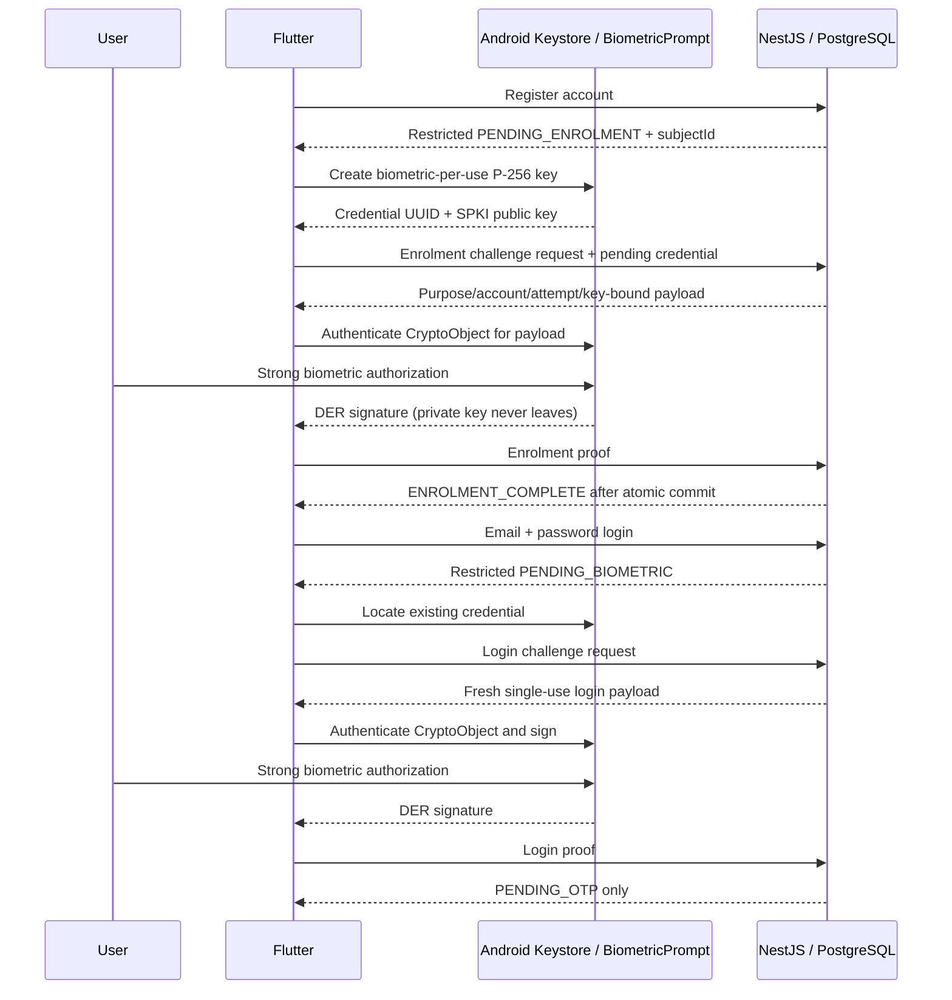

# Biometric security design — Phase 4

## Scope and trust boundary

Android biometric key enrolment and login challenge-response are implemented.
Verification stops at PENDING_OTP. No email code, access JWT, refresh token or
protected dashboard session is created. iOS signing is not implemented; it fails
closed with an explicit unsupported message rather than a mock.

The native Android path creates a P-256 key in AndroidKeyStore. The private key is
never exported, stored in preferences or transmitted. The backend receives only
SPKI public-key DER, an opaque credential UUID and ECDSA signatures. Biometric
images/templates stay with Android. local_auth remains capability/UI discovery;
it is not the backend proof and does not authorize an unrestricted signing key.

Native key generation sets PURPOSE_SIGN, SHA-256, authentication required, per-use
biometric authorization, and invalidation on biometric enrolment changes. Android
30+ uses setUserAuthenticationParameters(0, AUTH_BIOMETRIC_STRONG); Android 24–29
uses the equivalent per-operation duration -1. AndroidX Biometric 1.1.0 is the
stable CryptoObject integration. FlutterFragmentActivity and an AppCompat normal
theme support its prompt. No device-PIN fallback is allowed by the app prompt/key.
Android's own screen lock is a prerequisite for OS biometric enrolment, not an
AuthVault authentication alternative.

Signature.initSign runs on the Keystore private key before prompting. The Signature
is wrapped in BiometricPrompt.CryptoObject and only that authorized object signs
the exact decoded server payload bytes after successful OS authentication. A success
callback alone cannot supply a signature. Native code checks key non-exportability,
authentication requirement/type, per-use validity and enrolment-change invalidation.
It rejects unsafe properties and does not silently regenerate missing/invalid keys
during login. Only a restricted enrolment flow may create an initially absent key.

Key aliases are scoped to the server-authorized account UUID and a random credential
UUID. Alias discovery avoids storing private keys or credential lookup secrets in
preferences. Device identifiers are random credential identifiers, not IMEI or
other persistent hardware tracking IDs. Native calls and results contain no
biometric-success boolean used for server authorization.

**Hardware limitation:** the emulator's actual key reported hardwareBackedReported
false. Debug builds allow biometric-restricted AndroidKeyStore software backing for
emulator validation; they never substitute a software key generated by Dart or
stored in app preferences. Non-debug native operations reject keys whose KeyInfo
reports no secure-hardware backing. This local check is not remote attestation.

**Server trust assumption:** the server validates public-key possession and protocol
state, not a hardware attestation chain. It cannot independently prove that an
arbitrary modified/rooted client registered a hardware-backed, biometric-constrained
key. Production assurance against malicious enrolment clients requires Android key
attestation validation (trusted roots, challenge, chain/revocation, application and
key authorization properties) and a deployment policy. None of that assurance is
claimed by this prototype. An honest-client/OS trust assumption is explicit.

## Restricted contexts and credential lifecycle

Public registration creates an account and an expiring PENDING_ENROLMENT credential,
not a signed-in session. It authorizes only that account's first credential
challenge/proof. Password login creates PENDING_BIOMETRIC and cannot create or
replace credentials. The server rejects enrolment if any credential record already
exists for the user, including revoked records. Existing credentials are never
silently overwritten. The attempt becomes ENROLMENT_COMPLETE only after proof and
credential persistence commit; the user returns to password login afterward.

Login challenges require a non-revoked credential owned by the pending attempt's
user. Success consumes the challenge and moves only that attempt to PENDING_OTP.
Status/revocation support all restricted stages; completed dashboard access remains
unavailable. Attempts and challenges remain subject to server expiry even if the
client clock or local state is wrong.

Credential revocation is an administrative operation in this phase, not a password-
only API. A revoked credential is rejected at both issuance and verification.
Credential-row locks serialize concurrent administrative revocation with proof
acceptance. Client-reported key invalidation does not authorize replacement.

## Challenge contract and cryptography

Algorithm: ECDSA P-256 with SHA-256; SPKI DER public key, standard padded base64;
ASN.1 DER ECDSA signature, standard padded base64. No P1363 signature or algorithm
negotiation is accepted. Keys are parsed and curve/canonical encoding checked.
Signature and key input lengths are bounded; unknown DTO fields are rejected.

The server generates a 32-byte random nonce and UUID challenge identifier, with
expiry at most two minutes and never beyond the pending attempt expiry. It stores
the exact payload and sends its unpadded base64url encoding. The decoded payload
is UTF-8 server JSON with protocol authvault.biometric.v1, challengeId, purpose,
subjectId, attemptId, credentialId, publicKeyHash, nonce and expiresAt. publicKeyHash
is SHA-256 of SPKI DER. Flutter checks protocol/context fields but signs the exact
received bytes; it does not reserialize JSON.

Issuing a new challenge consumes all previous outstanding challenges for that
attempt. Proof checks token hash, pending stage, ownership, purpose, credential,
key fingerprint, both expiries and signature. PostgreSQL attempt-row locking
serializes issuance/verification; user-row locking protects first-enrolment
uniqueness, and credential-row locking protects credential status. Conditional
challenge consumption, credential insertion, stage transition and success audit
commit in one transaction. A competing request cannot successfully consume the
same challenge twice. Failure never advances state. Rejected proofs are audited
outside the rolled-back proof transaction without logging signatures or payloads.

IP limits from AuthModule apply. Authenticated attempts additionally permit five
challenge issuances and five proof submissions per ten-minute fixed window.
Invalid pending credentials do not consume an attempt's private quota. Generic
BIOMETRIC_REJECTED errors avoid distinguishing unknown/cross-user/revoked keys.

## Sequence

## Failure, cancellation and interruption

Flutter and native code prevent duplicate prompt/submission operations. Native
cancellation/backgrounding returns an error and never a signature to the cancelled
caller. Stale callbacks cannot complete a newer operation. Missing hardware,
missing enrolment, rejection, temporary/permanent lockout, missing/invalidated key,
unsafe protection and network failures have explicit fail-closed presentations.
Prompt creation exceptions are caught instead of crashing the activity.

A response lost after a successful backend commit is reconciled through pending
status; retry does not blindly overwrite a key or fabricate success. Cancel clears
the in-memory pending secret and attempts server revocation. Restart requires a new
password attempt; the Keystore credential persists independently. Cancellation of a
network request cannot undo an already committed server transaction.

## Recovery and physical-device validation

Device changes, missing keys, lock-screen removal and biometric-enrolment changes
must not fall back to password/PIN-only AuthVault access. No recovery or replacement
endpoint exists in Phase 4. An expired first-enrolment context also requires a
future verified recovery process; it is not silently reissued by password login.

A future process should require an existing enrolled device or separately enrolled
high-entropy recovery factor; loss of all factors needs reviewed identity proof,
notifications/cooling-off and revocation of old credentials/attempts/sessions before
controlled re-enrolment. Email/password alone must not overwrite a registered key.
This is a design proposal, not implemented functionality.

Physical Android tests remain required for real TEE/StrongBox backing, hardware
attestation, biometric set changes and key invalidation across vendors, lockout,
reboot persistence, screen-lock removal, strong face sensors and OS versions
24–29/30+. Emulator/mocked tests do not establish genuine-user or impostor rates.

References: [Android biometric guide](https://developer.android.com/identity/sign-in/biometric-auth),
[KeyGenParameterSpec](https://developer.android.com/reference/android/security/keystore/KeyGenParameterSpec.Builder),
[CryptoObject](https://developer.android.com/reference/android/hardware/biometrics/BiometricPrompt.CryptoObject),
[AndroidX stable release](https://developer.android.com/jetpack/androidx/releases/biometric).
