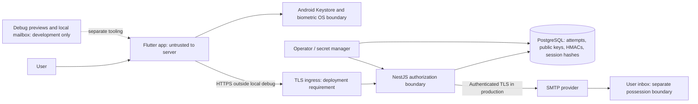

# AuthVault threat model — Phase 6

Scope: current academic Flutter/Android and NestJS/PostgreSQL prototype. This model
separates implemented controls from tested behavior and proposed production work.

## Assets and boundaries

Assets: password hashes; device private signing keys; pending MFA credentials;
OTP verification secret/digests; access/refresh credentials; account identity;
authentication audits; signing/SMTP/database secrets; availability.

A malicious client can modify navigation/state, submit arbitrary HTTP and generate
software keys. Client UI is never an authorization boundary. Server authority is
conditioned on protecting its signing/HMAC secrets and database writes. Keystore
policy is enforced locally by an honest, uncompromised Android OS/client; server
attestation of that policy is absent. SMTP acceptance does not guarantee inbox
arrival or inbox confidentiality. Public TLS ingress is documented, not deployed.

## Actors and threats

| Actor / action | Implemented control | Tested evidence | Residual / proposed |
| --- | --- | --- | --- |
| Unauthenticated caller guesses passwords | Argon2id, dummy verification, generic login, account/IP quotas | Wrong/unknown login and spoofed-IP quota tests | Signup still enumerates; distributed admission/load remains open |
| Caller skips a stage or fabricates client session | Separate pending tokens, server stage/ownership checks, JWT/live session guard | Direct OTP before biometric, pending Bearer, unsigned/wrong-key JWT, forged-state fields rejected | Compromised server/secret infrastructure outside this local proof |
| Attacker replays or swaps signed challenges | Nonce/purpose/user/attempt/key binding, expiry and transactional consumption | Cross-user, altered/forged/reused/concurrent signatures rejected | Malicious new client can enrol a software key; attestation required |
| Caller guesses/replays/swaps OTPs | HMAC with separate secret and IDs, five failures, user lockout, quotas, replacement and locks | Wrong, expired, cross-attempt, reused and concurrent verification tests | Phishing/inbox compromise; multiple-attempt threat needs edge/operational controls |
| Refresh thief reuses a rotated token | Hashed random refresh, locked rotation and family revocation | Replay and parallel reuse revoke family, including winner | Bearer stolen before use can race legitimate device; refresh is not fresh proof of private-key possession |
| Former session user continues after logout | Live DB session/credential guard | Access JWT and refresh rejected after server logout | Already-authorized requests may finish; offline/failed cleanup uncertainty remains |
| Local race / interrupted application | Secure storage, serialized writes, generation checks, no automatic restoration retries | Delayed read/write, logout, expiry, offline/recovery fixtures | Platform storage crash consistency not formally verified; unfinished MFA discarded |
| Compromised/modified mobile OS | Non-exportable auth-per-use key in stock Android, release local hardware check | Emulator native signature/cancellation; no exported private key API found | Rooted OS, hooking, attestation absence and physical-device behavior unproven |
| Database reader obtains OTP/session tables | OTP HMAC and high-entropy refresh hashes; Argon2 password hashes | Stored material and response checks in integration tests | A reader with app secrets can attack OTPs; database writer can subvert authority |
| SMTP/network attacker | Production SMTP requires TLS/auth; release API URL/cleartext policy | Configuration tests, local SMTP acceptance/failure, compiled manifest inspection | Real provider, TLS/DNS, certificate operations and external delivery untested |
| Resource attacker / growing database | Shared auth quotas, expiry validation, indexed lookups | Quota/expiry tests and small local measurements | Cleanup, capacity, authenticated-read quota, backups and monitoring open |

## Important assumptions

- Pending and refresh credentials are bearer capabilities, not device-bound transport
  credentials. Logical binding to a registered key is not a fresh possession proof
  on every API request.
- No key replacement, password reset or recovery bypass is implemented. Lost keys
  can strand legitimate accounts; email/password-only recovery must not be invented.
- Debug mode permits emulator OS-managed software-backed Keystore keys; production
  client requires reported hardware backing, but the server cannot trust modified
  clients without attestation. Native fixture success is not hardware proof.
- Controlled tests own their accounts and mailbox and run only on local services.
  Test code reads the mailbox; the shipping app does not. No production accounts,
  DNS, SMTP credentials or infrastructure are introduced by this phase.
- Device/inbox/server compromise, real phishing studies and production capacity are
  residual risks, not claims that those attacks were independently executed here.

Prioritization and ownership are in [audit risk register](phase-6-security-audit.md)
and [readiness gates](production-readiness.md). The complete implemented MFA sequence
remains in [Phase 5 implementation](phase-5-implementation.md).
